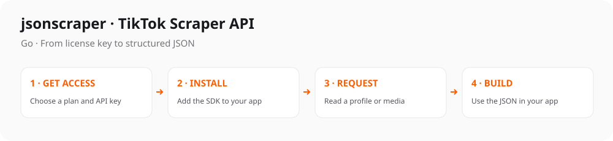

# TikTok Scraper API for Go

[](https://github.com/jsonscraper/tiktok-api-go/tags)
[](#quick-start)
[](https://github.com/jsonscraper/tiktok-api-go/commits)
[](LICENSE)
[](https://www.postman.com/evelode/workspace/evelode/collection/24862082-d886cc87-4267-4e0c-b57a-2d083add50ad)

A small, configurable client with named methods and ready-to-run examples. Supports **54 TikTok Scraper API methods**.

**Package:** `github.com/jsonscraper/tiktok-api-go` · **[Methods](#main-methods)** · **[Examples](#ready-to-run-examples)** · **[Documentation](docs/guide.md)**



## Quick start

**1. Get your key** from the [TikTok API product page](https://jsonscraper.com/services/tiktok-scraper-api?utm_source=github&utm_medium=sdk&utm_campaign=tiktok-api-go&utm_content=readme) and set it on your server:

```sh
export JSONSCRAPER_TIKTOK_LICENSE_KEY='your-license-key'
```

**2. Install the package:**

```sh
go get github.com/jsonscraper/tiktok-api-go@v0.1.1
```

**3. Make a request:**

```go
package main
import (
 "context"
 "fmt"
 "os"
 "net/url"
 sdk "github.com/jsonscraper/tiktok-api-go"
)
func main() {
 client, err := sdk.NewTikTok(os.Getenv("JSONSCRAPER_TIKTOK_LICENSE_KEY"), sdk.Options{})
 if err != nil { panic(err) }
 response, err := client.GetUserInfo(context.Background(), url.Values{"query":{"therock"}, "cache_timeout":{"60"}})
 if err != nil { panic(err) }
 fmt.Println(string(response.Body))
}
```

The API payload is in `tiktok`. Live calls require a valid API license and may consume quota. [Response examples and status handling](docs/responses.md).

## Main methods

54 methods are available. Common starting points:

| What you need | Method |
| --- | --- |
| Read a profile | `GetUserInfo()` |
| Read a video | `GetVideoById()` |
| Get a video download URL | `GetNoWatermarkUrl()` |
| Read comments | `GetCommentsById()` |
| Search videos | `SearchVideo()` |
| List profile videos | `GetUserFeed()` |

[All methods and parameters →](docs/endpoints.md)

## Ready-to-run examples

- [Read a profile](examples/endpoints/get_user_info.go).
- [Read a video](examples/endpoints/get_video_by_id.go).
- [Read comments](examples/endpoints/get_comments_by_id.go).
- [Search videos](examples/endpoints/search_video.go).
- [List profile videos](examples/endpoints/get_user_feed.go).

Each example includes command-line parameters, key setup, timeouts, error handling and response output. Run it with `--help` first; this makes no API request.

**[Browse all 54 complete examples](examples/README.md)** · **[Full method and parameter reference](docs/endpoints.md)**

## Configuration

Requests use a 30-second timeout by default. Configure caching and retries to fit your application's request budget. Keys are read from your server environment; redirects are disabled.

[Configuration options, HTTP errors, caching and pagination](docs/configuration.md) · [Full integration guide](docs/guide.md)

## Use with ChatGPT and Codex

Prefer an assistant connection? Use the separate [TikTok MCP server](https://jsonscraper.com/mcp/tiktok?utm_source=github&utm_medium=sdk&utm_campaign=tiktok-api-go&utm_content=mcp). It accepts the same product API license and uses the normal API quota. [MCP source and setup](https://github.com/jsonscraper/tiktok-mcp-server).

## Access, pricing and support

The SDK source is **MIT-licensed**. Hosted API access requires a separate TikTok license. Check [current plans and get access](https://jsonscraper.com/services/tiktok-scraper-api?utm_source=github&utm_medium=sdk&utm_campaign=tiktok-api-go&utm_content=readme).

[Service support](https://jsonscraper.com/contacts?utm_source=github&utm_medium=sdk&utm_campaign=tiktok-api-go&utm_content=support) · [SDK issues](https://github.com/jsonscraper/tiktok-api-go/issues) · [Changelog](CHANGELOG.md) · [MIT license](LICENSE)

## Development

```sh
python3 tests/contract.py
```

Tests use a local/mock server and require no API key. A [GitHub Actions template](docs/github-actions.yml) is available for optional automation.

The SDK has no installation or usage telemetry. README links use campaign parameters for website referral analytics. jsonscraper is independent and is not affiliated with TikTok.
